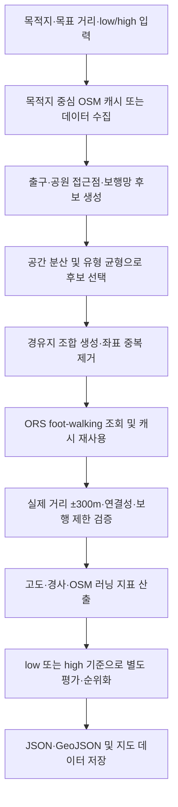

# Less GO

Less GO는 역사문화 장소에 도착하는 러닝 코스를 추천하고, 저장된 경로를 지도와 영어 음성 안내에서 활용하는 프로젝트입니다. 목적지·거리·경사 선호를 기준으로 경로를 선택할 수 있습니다.

- 목적지: 심우장 (`simujang`), 정릉 (`jeongneung`), 의릉 (`uiryeong`)
- 목표 거리: 3km, 5km, 10km
- 현재 경사 선호: `low`(경사 부담을 낮추는 방향), `high`(러닝 적합성을 유지하며 언덕을 더 허용)
- 호환성: 기존 API의 `any` 요청은 `high`에 대응합니다. `any`를 사용하는 과거 데이터·실험 결과는 아래에 별도로 표시합니다.
- 러닝 완료 후 한국어·영어 역사 해설 제공을 목표로 합니다. 현재 제공물은 대본 데이터이며 앱 화면과 해설 TTS는 별도 구현이 필요합니다.

## 핵심 기능 및 구현 상태

| 기능 | 상태 | 설명 |
|---|---|---|
| ORS 보행 경로 탐색 | 구현됨 | ORS Directions `foot-walking`으로 실제 보행 경로와 방향 안내 단계를 계산합니다. API 탐색에는 ORS 키와 인터넷 연결이 필요합니다. |
| 목적지·거리·경사별 경로 데이터 | 데이터 번들 준비됨 | 최신 앱 연동 번들은 `outputs/react_vite_integration_20261103_final/`에 있습니다. React 앱에 실제 연결되었는지는 확인되지 않았습니다. |
| OSM 후보·제약 검토 | 일부 구현 | OSM에서 출발지·경유지 후보와 도로 속성을 수집하고 매칭합니다. 누락 태그는 현장 통행이나 안전을 증명하지 않습니다. |
| 경사 및 러닝 친화도 평가 | 구현됨 | ORS 고도 프로필과 OSM 매칭 지표를 계산합니다. 자세한 공식은 [경로 추천 알고리즘 문서](docs/ROUTING_ALGORITHM.md)를 참고하세요. |
| Kakao 지도 경로 표시 | 구현됨 | 로컬 Python 서버가 저장 GeoJSON을 Kakao Maps JavaScript SDK 위에 표시합니다. 지도에서 경로를 다시 계산하지 않습니다. |
| 영어 음성 내비게이션 | 구현됨, 실제 기기 검증 미완료 | 저장된 ORS 안내 단계, GPS 또는 시뮬레이션, 브라우저 Web Speech API(`en-US`)를 사용합니다. |
| 한국어·영어 역사 해설 데이터 | 구현됨 | 세 유적지의 6개 대본이 [`data/narrations.json`](data/narrations.json)에 있습니다. |
| 역사 해설 화면·TTS | 미구현 | 앱의 완주 이벤트 연결, 해설 화면, 언어 선택과 앱 TTS 연동이 필요합니다. |
| 실제 출입구·안전·노면 현장 확인 | 미완료 | 자동 경로 검증은 현장 개방 여부, 안전, 실제 노면 상태를 보증하지 않습니다. |

## 알고리즘 흐름

이 프로젝트는 후보 탐색과 규칙 기반 평가를 사용합니다. 머신러닝 모델을 사용하지 않습니다. 구현 세부 사항은 [docs/ROUTING_ALGORITHM.md](docs/ROUTING_ALGORITHM.md)에 정리했습니다.

## 최신 앱 연동 데이터 (2026-11-03)

최신 앱 연동 데이터 번들은 심우장·정릉·의릉 3곳, 3·5·10km 3종, Low/High 2종으로 구성된 **18개 슬롯**을 제공합니다. 번들 검수에서 앱 시연용 Low/High 9쌍 모두 서로 다른 실제 ORS geometry를 사용하는 것을 확인했습니다.

- [routes.json](outputs/react_vite_integration_20261103_final/routes.json): 슬롯 인덱스, 경로 지표, 경고 및 저장된 ORS directions
- [routes.geojson](outputs/react_vite_integration_20261103_final/routes.geojson): 실제 저장된 ORS 경로 geometry
- [React/Vite 데이터 사용 안내](outputs/react_vite_integration_20261103_final/README.md): 로딩·모드 선택·지도 표현 가이드
- [검수 보고서](outputs/react_vite_integration_20261103_final/audit_report.md): 슬롯 및 페어 검증 결과와 남은 확인 사항

이 번들은 앱에서 읽을 수 있는 데이터 준비 상태를 뜻합니다. **현재 React/Vite 앱에 이 번들이 실제 연결되었는지는 확인되지 않았으며, 연동 완료로 간주하지 않습니다.**

정릉 5km 시연용 Low/High는 v5 검토 경로를 선택하지만 두 경로 모두 `review_required`, `formal_recommendation: false`, 고도 신뢰도 `low` 상태입니다. 고도 불확실성, 출입구와 보행 환경에 대한 현장 확인이 남아 있어 정식 추천으로 표시하면 안 됩니다. 다른 경로도 자동 검수는 현장 안전이나 실제 개방을 보증하지 않습니다. 번들의 각 경고와 검증 상태를 앱에서 유지하세요.

### 과거 실험 결과 (2026-11-01, historical)

아래 표는 2026-11-01 당시 `low/any` 방식을 사용한 과거 실험 데이터의 18개 대표 경로입니다. 최신 앱 연동 데이터와 별개이며, 현재 Low/High 구성이나 9쌍 geometry 검증 결과를 나타내지 않습니다. 당시 자동 검증에서 모두 `needs_verification`으로 남아 현장 확인이 완료된 경로가 아니었습니다.

| 목적지 | 거리 | 모드 | 실제 거리 km | ORS 예상 도보 시간 분 | 상승 m | 러닝 점수 /100 |
|---|---:|---|---:|---:|---:|---:|
| 심우장 | 3 | low | 3.0799 | 37.0 | 126.9 | 39.29 |
| 심우장 | 3 | any | 3.0253 | 36.3 | 135.2 | 43.64 |
| 심우장 | 5 | low | 5.1532 | 61.8 | 180.4 | 19.38 |
| 심우장 | 5 | any | 4.8701 | 58.4 | 180.9 | 64.26 |
| 심우장 | 10 | low | 9.9502 | 119.4 | 261.0 | 50.56 |
| 심우장 | 10 | any | 9.9502 | 119.4 | 261.0 | 50.56 |
| 정릉 | 3 | low | 2.9495 | 35.4 | 128.1 | 48.64 |
| 정릉 | 3 | any | 2.9888 | 35.9 | 110.8 | 41.12 |
| 정릉 | 5 | low | 5.1945 | 62.3 | 216.5 | 18.14 |
| 정릉 | 5 | any | 4.8620 | 58.3 | 180.6 | 40.06 |
| 정릉 | 10 | low | 9.9385 | 119.3 | 177.3 | 79.55 |
| 정릉 | 10 | any | 9.9385 | 119.3 | 177.3 | 79.55 |
| 의릉 | 3 | low | 2.9485 | 35.4 | 37.6 | 49.36 |
| 의릉 | 3 | any | 2.9735 | 35.7 | 36.7 | 50.55 |
| 의릉 | 5 | low | 4.7994 | 57.6 | 58.6 | 62.26 |
| 의릉 | 5 | any | 4.7994 | 57.6 | 58.6 | 62.26 |
| 의릉 | 10 | low | 10.1250 | 121.5 | 100.1 | 65.26 |
| 의릉 | 10 | any | 10.1355 | 121.6 | 133.7 | 56.67 |

`ORS 예상 도보 시간`은 ORS 보행 프로필의 시간이며 달리기 예상 시간은 아닙니다. 러닝 점수는 OSM에 매핑된 도로 속성의 추정치입니다. 구성별 비교, 급경사 비율과 경로 ID는 [최종 대표 경로 인덱스](analysis/experiments/final_routes_20261101/outputs/app/representative_routes.json)와 상세 [알고리즘 문서](docs/ROUTING_ALGORITHM.md)에서 확인할 수 있습니다.

이 표의 원본 인덱스는 [`analysis/experiments/final_routes_20261101/outputs/app/representative_routes.json`](analysis/experiments/final_routes_20261101/outputs/app/representative_routes.json)에 보존되어 있습니다. 과거 데이터의 `any` 값은 최신 번들의 `high` 키와 구분해 읽으세요.

## 앱 개발자 빠른 시작

| 용도 | 파일 |
|---|---|
| 최신 앱 연동 데이터 인덱스 | [`outputs/react_vite_integration_20261103_final/routes.json`](outputs/react_vite_integration_20261103_final/routes.json) |
| 최신 실제 ORS 경로 geometry | [`outputs/react_vite_integration_20261103_final/routes.geojson`](outputs/react_vite_integration_20261103_final/routes.geojson) |
| 최신 번들 개발자 안내 | [`outputs/react_vite_integration_20261103_final/README.md`](outputs/react_vite_integration_20261103_final/README.md) |
| 2026-11-01 과거 실험 인덱스 | [`analysis/experiments/final_routes_20261101/outputs/app/representative_routes.json`](analysis/experiments/final_routes_20261101/outputs/app/representative_routes.json) (`low/any`, historical) |
| 영어 음성 내비게이션 | [`web/english_voice_navigation.js`](web/english_voice_navigation.js), [`src/navigation_data.py`](src/navigation_data.py) |
| 한국어·영어 해설 원문 | [`data/narrations.json`](data/narrations.json) |
| 앱 데이터 연동 안내 | [`docs/APP_INTEGRATION.md`](docs/APP_INTEGRATION.md) |
| 알고리즘 설명 | [`docs/ROUTING_ALGORITHM.md`](docs/ROUTING_ALGORITHM.md) |
| 웹앱(성북 런트립, React) | [`app/`](app/) — 사용법은 [`app/README.md`](app/README.md) |
| 앱 데이터 변환 | [`export_runtrip.py`](export_runtrip.py), [`src/runtrip_export.py`](src/runtrip_export.py) |

## 웹앱 실행

`app/`은 React + Vite 웹앱입니다. 최신 경로 번들은 별도 폴더에 준비되어 있습니다. 이 README 작성 시점에 앱에서 번들을 실제로 불러오는지는 확인되지 않았으므로, 연동 완료로 간주하지 마세요. 데이터 로딩 방법은 번들 [README](outputs/react_vite_integration_20261103_final/README.md)를 참고하세요.

~~~powershell
cd app
npm install
npm run dev
~~~

`http://localhost:5173/`을 엽니다. 아래 내보내기 명령은 기존 데이터 변환 흐름입니다. 최신 번들을 앱에 연결하는 방법은 번들 README를 따르며, 이 명령만으로 최신 번들이 연결되는 것은 아닙니다.

~~~powershell
python export_runtrip.py
~~~

과거 low/any 내보내기에서는 경로가 같은 조합을 합쳐 15개로 처리했습니다. LessGo에는 가로등·유동인구·주거지 데이터가 없어서 `lamps`, `crowd`, `residential`은 기본값(2, `mid`, `false`)으로 채워집니다.

최신 번들의 인덱스 구조 및 `destinations[destination_id].distances[distance].routes[mode]` 조회 방법은 번들 [README](outputs/react_vite_integration_20261103_final/README.md)를 참고하세요. 과거 인덱스는 `destinations[destination_id][distance].modes["low"|"any"]` 구조를 사용합니다. 두 구조와 모드 이름은 서로 구분해 처리하세요.

## 프로젝트 구조

~~~text
.
├── data/                       # 목적지·탐색 설정·제약·역사 해설
├── docs/                       # 알고리즘 상세 문서
├── outputs/
│   ├── app/                    # 기본 앱 대표 경로 인덱스
│   ├── recommendations/        # 기존 지도용 경로 파일
│   └── cache/                  # 로컬 ORS·OSM 캐시 (Git 제외)
├── analysis/experiments/       # 재현·검증용 실험 및 최종 18개 데이터
├── app/                        # 성북 런트립 웹앱 (React + Vite)
├── src/                        # 경로 계산·OSM 및 경사·러닝 평가
├── tests/                      # 자동 테스트
├── web/                        # Kakao 지도와 영어 음성 안내
├── main.py                     # 추천 실행 CLI
├── serve_kakao_map.py          # 로컬 지도/API 서버
└── requirements.txt
~~~

주요 설정은 `data/destinations.json`, `data/route_defaults.json`, `data/route_exclusions.json`, `data/running_fitness.json`에 있습니다.

## 로컬 실행

PowerShell에서 프로젝트 폴더를 열고 가상환경을 준비합니다.

~~~powershell
py -m venv .venv
.\.venv\Scripts\Activate.ps1
pip install -r requirements.txt
Copy-Item .env.example .env
~~~

`.env`에 본인이 발급한 `ORS_API_KEY`와 `KAKAO_JS_KEY`를 입력합니다. 실제 `.env`는 Git에서 제외됩니다. Kakao JavaScript 키는 브라우저에 전달되므로 Kakao Developers에서 `http://localhost:8000` 등 허용 도메인을 제한하세요.

기존 Kakao 지도 서버를 실행하려면:

~~~powershell
python serve_kakao_map.py
~~~

기본 화면은 `http://localhost:8000/`입니다. 최종 18개 실험 데이터를 선택해 보려면 다음 주소를 엽니다.

~~~text
http://localhost:8000/?dataset=final_routes&destination=simujang&distance=3&slope=compare&strategy=running_focused
~~~

저장된 영어 안내 로직 테스트:

~~~powershell
node --test tests/english_voice_navigation.test.cjs
~~~

새 코스를 ORS로 탐색하는 예시(외부 API 호출):

~~~powershell
python main.py --recommend --destination-id uiryeong --target-distance-km 3 --slope-preference low --running-focused
~~~

## 사용 기술

- Python: OSM/ORS 데이터 수집, 경로 후보 탐색·평가, 로컬 HTTP 서버
- OpenRouteService: `foot-walking` 경로 및 방향 안내 데이터
- OpenStreetMap / Overpass: 보행 네트워크와 매핑된 장소·도로 속성
- Folium: 생성 결과용 HTML 지도
- Kakao Maps JavaScript SDK: 저장된 경로 시각화
- Browser Geolocation API / Web Speech API: GPS 위치와 영어 음성 안내
- JSON / GeoJSON: 경로, 설정, 해설 데이터

## 현재 한계 및 주의사항

- 최신 번들은 18개 선택 슬롯과 Low/High geometry가 다른 9개 페어를 제공합니다. 실제 React 앱 연결 여부는 확인되지 않았습니다.
- 정릉 5km 시연 페어는 `review_required`, `formal_recommendation=false`, 고도 신뢰도 `low`입니다. 정식 검증이 완료되지 않았으며 현장 안전·출입구 확인도 남아 있습니다.
- 최신 번들 검수에는 심우장 5km Low의 반복 edge 400.9m 및 낮은 러닝 점수, 심우장 10km Low의 9.2093km 거리와 High의 약 133m 계단 추정, 정릉 3km의 73.8% 공유 도로율과 작은 경사부담 차이가 남은 확인 사항으로 기록되어 있습니다.
- 2026-11-01 표와 인덱스는 과거 `low/any` 실험입니다. 당시 심우장 10km·정릉 10km·의릉 5km는 같은 geometry를 공유했으며 최신 앱 시연 번들과 혼동하지 마세요.
- GPS 음성 안내는 구현됐으나 실제 휴대전화·야외 수신 품질은 검증되지 않았습니다. 브라우저 위치 권한 및 HTTPS 또는 `localhost`가 필요합니다.
- 역사 해설은 JSON만 있습니다. 완주 이벤트 처리, 앱 UI, 언어 선택 및 앱 TTS는 별도 구현해야 합니다.
- ORS 시간은 걷기 경로 시간이며 러닝 페이스를 반영하지 않습니다.
- OSM 태그 기반 러닝 점수·차량 분리·횡단 정보는 매핑 데이터의 추정입니다. 안전이나 실제 개방을 보증하지 않습니다.
- `serve_kakao_map.py`는 `127.0.0.1:8000`에 바인딩하는 개발 서버로 인터넷 배포용이 아닙니다.
- `outputs/cache/`, 로그, 백업 및 로컬 실험 캐시는 실행 자료입니다. `.gitignore` 규칙을 확인하고 앱용 코스 파일과 혼동하지 마세요.