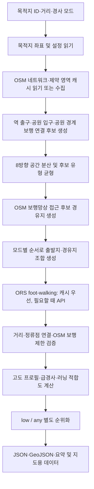

# Less GO 경로 추천 알고리즘

이 문서는 현재 저장소의 Python 코드, `data/*.json` 설정, 그리고 `analysis/experiments/final_routes_20261101/`의 최종 실험 인덱스를 기준으로 작성했습니다. 구현되지 않은 동작은 추정하지 않습니다. 해당 최종 산출물은 기존 앱용 인덱스에 자동 승격되지 않은 별도 데이터셋입니다.

## 실행 흐름

주요 구현 파일은 [`src/recommender.py`](../src/recommender.py), [`src/osm_data.py`](../src/osm_data.py), [`src/routing.py`](../src/routing.py), [`src/running_metrics.py`](../src/running_metrics.py)이며 설정은 [`data/route_defaults.json`](../data/route_defaults.json), [`data/running_fitness.json`](../data/running_fitness.json), [`data/route_exclusions.json`](../data/route_exclusions.json)에 있습니다.

## 출발지와 경유지 후보

### 출발지

`build_osm_candidates()`는 목적지 기준 OSM 응답에서 다음을 읽습니다.

- `railway=subway_entrance`, `public_transport=entrance` 등의 역 출입구 노드
- `leisure=park_entrance` 등 명시된 공원 입구
- 공원 폴리곤 경계와 실제 OSM 보행로가 만나는 곳에서 얻은 공원 보행 연결 후보
- 목적지 주변의 보행 네트워크 접근 후보

같은 좌표의 출발 후보는 좌표 기준으로 중복 제거합니다. 공원 경계에서 만든 접근 후보는 새 좌표를 임의 생성하지 않고 지도에 있는 보행로 정점을 사용하며, 현장 검증 전까지 확인 필요 상태로 둡니다. 카테고리·방향·공간 분산을 고려해 running-focused 탐색에서 최대 32개 출발지를 선택합니다. 역 출구가 항상 우선되도록 하드코딩하지 않습니다.

### 경유지

경유지는 OSM에 매핑된 공원·보행 접근점, 횡단점, 역 출입구, 보행 네트워크 지점 등에서 구성됩니다. 계단 전용 후보와 보행 허용이 확인되지 않은 자전거도로 후보는 필터링합니다. 후보 좌표를 목적지 기준 방향·반경·유형으로 분산시킨 뒤 조합을 생성합니다. 조합 전 좌표 중복을 제거하고 목표 거리 추정이 지나치게 벗어나는 조합을 사전 제외합니다. 이 사전 거리 계산은 탐색 순서용 직선거리 추정일 뿐, 최종 거리는 ORS 값으로 판정합니다.

`low`와 `any`는 공통 OSM 후보군을 사용하지만 조합 탐색 순서는 다릅니다. 두 모드 모두 목표 거리 ±300m 및 선호 거리 ±50m 구간을 우선합니다. 그 안에서 `low`는 거리 오차와 출발 접근·러닝 태그 점수를 먼저 고려하고, `any`는 매핑된 러닝 도로 점수를 더 앞에 둡니다. 출발 위치나 방위만으로 경사를 추정하지 않습니다.

## ORS 보행 경로

[`src/routing.py`](../src/routing.py)의 `fetch_walking_route_points()`는 정류점의 좌표를 `[longitude, latitude]` 순서로 ORS에 보내고 `foot-walking` Directions GeoJSON을 요청합니다. 요청은 방향 안내 `instructions`, 고도 `elevation`, steepness 추가 정보를 설정합니다. uncached 요청은 초당 최대 1회로 제한하고, 일시 오류만 제한적으로 재시도합니다. 401/403과 429는 무한 재시도하지 않습니다.

동일한 정류점 조합에 대해서는 로컬 ORS 응답 캐시를 먼저 사용합니다. 캐시 데이터도 경로가 존재한다는 사실만으로 유효 처리하지 않습니다. 현재 실행의 OSM 제한 태그, 연결성, 거리, 경사 및 러닝 지표로 다시 평가합니다. ORS 응답은 실제 보행 라우터가 반환한 선형 경로이며, 문서나 지도에서 좌표를 직선으로 이어 실제 경로인 것처럼 만들지 않습니다.

## OSM 보행 제한 및 연결성

`data/route_exclusions.json` 및 OSM 캐시의 학교·궁궐 등 경계 데이터를 제한 또는 참고 영역으로 구성합니다. 실제 ORS 경로선을 일정 간격으로 표본화해 제한 폴리곤과 겹치는지를 확인합니다. 명시적 제한으로 판정된 경로는 추천 후보에서 제외합니다. 단순 경계 중첩과 통행 제한 태그를 같은 의미로 보지 않습니다.

경로 좌표를 OSM 보행 네트워크 edge에 공간 매칭하여 보행로, 도로, 계단, 자전거도로, 반복 edge, 횡단 관련 OSM 정보를 계산합니다. `access=no/private` 또는 `foot=no`와 같은 명시적 제한은 보행 적합 판단에 반영됩니다. `highway=cycleway`는 `foot=yes/designated/permissive`가 매핑된 경우에만 보행 허용 경로로 간주합니다. 매칭되지 않은 도로 부분은 “안전”이나 “보행 가능”으로 추정하지 않고 미확인 비율에 남깁니다.

경로의 시작·경유·도착점은 ORS geometry에 대한 최근접 거리로 연결 여부를 계산합니다. 러닝 지표의 정류점 snap 허용치는 50m입니다. 이는 라우팅 네트워크 연결을 확인하는 자동 검사이지 실제 입구의 개방 여부를 확인하는 검사가 아닙니다.

## 거리 허용 기준

[`data/route_defaults.json`](../data/route_defaults.json)의 `distance_tolerance_min_m`은 300m, `preferred_distance_error_m`는 50m입니다. 따라서 목표 범위는 다음과 같습니다.

| 목표 | 허용 거리 |
|---:|---:|
| 3km | 2.7–3.3km |
| 5km | 4.7–5.3km |
| 10km | 9.7–10.3km |

조합 생성 단계의 직선거리 추정은 탐색 우선순위/후보 사전 필터 용도입니다. 성공 여부는 ORS가 반환한 실제 route distance로 다시 검사합니다. 거리 점수는 오차가 작을수록 높고, ±50m 이내에는 추가 점수를 줍니다. ±300m 밖의 경로는 기본 추천 범위 밖입니다.

## 고도와 급경사

ORS geometry 좌표의 고도값이 완전하게 있을 때 거리 기준 누적 고도 프로필을 만듭니다. [`_grade_metrics()`](../src/recommender.py)는 약 20m 간격으로 프로필을 재표본화하고 60m 중앙값 창으로 평활화한 다음, 100m 지속 구간의 상승률과 8%·10% 이상 오르막 구간을 계산합니다. 급경사 구간의 연속 길이, 최대 지속 오르막 경사, 상승고도도 함께 저장합니다.

구간별 경사는 고도 차이를 실제 좌표 사이 수평거리로 나누어 산출합니다. 최대 원본 고도 샘플 간격이 설정한 100m 경고 기준을 넘으면 품질 경고를 남깁니다. 이 값은 평탄하게 임의 보정하지 않습니다. 표본 간격이 크면 그 구간의 경사 수치는 불확실성이 커질 수 있습니다.

`duration_minutes`는 ORS 보행 경로 예상 시간입니다. 러닝 페이스 기반 소요 시간은 계산하지 않습니다.

## 실제 Low / Any 점수와 선정 규칙

관련 설정은 `running_score_weights`, `grade_assessment.mode_penalties`, `running_fitness.route_score_weights`입니다. running-focused 평가에서는 기본 점수 가중치의 비율을 유지한 채 그 합을 러닝 친화도 비중만큼 줄이고, running fitness 비중을 더해 총합을 1로 정규화합니다.

| 구성 점수 | Low 최종 가중치 | Any 최종 가중치 |
|---|---:|---:|
| 거리 적합도 | 14.4% | 15.84% |
| 매핑된 횡단 점수 | 8.0% | 10.8% |
| 경로 직접성·연속성 점수 | 8.0% | 17.28% |
| 경사 점수 | 30.4% | 2.16% |
| OSM 보행성 점수 | 6.4% | 18.0% |
| OSM 러닝 친화도 | 20.0% | 28.0% |
| 출발 접근 점수 | 12.8% | 7.92% |

이 가중합 점수만으로 양 모드가 동일한 방식으로 정렬되는 것은 아닙니다. `running_focused`의 실제 순위 함수 `_route_rank_key()`는 다음과 같습니다.

- **Low:** 먼저 완만한 기준 충족 여부를 우선합니다. 완만 기준은 거리 범위 안에서 상승고도 `목표 km × 33.333m` 이하, 8% 이상 오르막 비율 12% 이하, 최대 지속 오르막 8% 이하입니다. 이어서 `0.85 × 지형 부담 + 0.15 × (100 − 러닝 친화도)`를 오름차순으로 비교하고, 거리 오차로 동률을 풉니다.
- **Any:** 경사 가능 여부로 경로를 우대하지 않습니다. 앞의 총점(러닝 focused 점수)을 내림차순으로 정렬하고 거리 오차로 동률을 풉니다.

지형 부담 공식은 다음과 같습니다. `share8`, `share10`은 경로 길이 대비 비율(0–1), `ascent_per_km`은 목표 km당 상승 m입니다.

~~~text
terrain_burden = share10 × 400
               + share8 × 200
               + max_sustained_uphill_grade_percent × 1.5
               + longest_continuous_8_percent_uphill_m / (target_km × 10)
               + ascent_per_km × 0.05
~~~

점수용 경사 점수도 저장합니다.

~~~text
slope_score = clamp_0_100(
  100 − share8 × penalty8 − share10 × penalty10
      − min(1, max_sustained_grade / 12) × sustained_penalty
      − min(1, longest_8m / 300) × long_climb_penalty
      − min(1, ascent_per_km / 80) × ascent_penalty
)
~~~

경사 페널티 설정은 다음과 같습니다.

| 지표 페널티 계수 | Low | Any |
|---|---:|---:|
| 8% 이상 오르막 비율 | 35 | 12 |
| 10% 이상 오르막 비율 | 25 | 8 |
| 최대 지속 오르막 | 20 | 8 |
| 연속 8% 오르막 | 10 | 4 |
| 상승고도/km | 10 | 8 |

## 러닝 친화도 점수

`src/running_metrics.py`는 OSM 도로 종류와 태그를 경로 좌표에 매칭합니다. 점수는 **지도에 기록된 속성의 추정치**이고, 안전성 확인이나 실제 달리기 편의 보증이 아닙니다. 도로 종류 점수, 노면·smoothness 조정, width 정보가 매핑되어 있으면 그 값을 0–100 범위로 제한합니다. 누락 또는 불확실한 값은 정상값으로 채우지 않습니다.

`data/running_fitness.json`의 구성 요소와 가중치는 다음과 같습니다.

| 설정 요소 | 내부 지표 | 가중치 | 의미 |
|---|---|---:|---|
| `mapped_running_friendly_share` | `running_friendly_share` | 45% | 러닝 친화 태그로 분류되어 매칭된 경로 길이 비율 |
| `vehicle_separation_proxy_share` | `vehicle_separation_proxy_share` | 20% | 보행 전용/분리 도로 클래스 기반 차량 분리 추정 비율 |
| `continuous_run_estimate` | `continuous_running_estimate_score` | 20% | 매핑된 방해 지점 사이의 가장 긴 연속 구간 추정 점수 |
| `surface_and_width_quality` | `surface_width_quality_score` | 10% | 매칭된 노면·폭 품질의 길이 가중 평균 |
| `naturalness` | `naturalness_score` | 5% | U턴·급회전·반복 edge를 반영한 동선 점수 |

각 구성 지표는 0–100 범위입니다. `_weighted_fitness_score()`는 유효하고 존재하는 지표만 사용해 가중 평균을 다시 정규화합니다. 누락 값을 임의의 높은 점수로 대체하지 않습니다. 하천변 보너스는 OSM waterway 선형과 **보행 허용으로 분류되고 공간 매칭된 보행로** 관계가 확인될 때만 적용되며 최대 4점, 설정 절대 상한은 5점입니다. 하천 데이터가 없거나 보행 확인이 부족하면 보너스는 0점입니다.

## 최종 18개 경로 비교

출처는 [`최종 실험 인덱스`](../analysis/experiments/final_routes_20261101/outputs/app/representative_routes.json)입니다. 아래 상승고도와 점수는 모드별 선택 경로에 기록된 값이며, 8%·10%는 해당 경로 거리 중 오르막 비율입니다.

| 목적지 | 목표 | 모드 | 출발지 | 거리 km | 상승 m | 오르막 ≥8% | 오르막 ≥10% | 러닝 /100 |
|---|---:|---|---|---:|---:|---:|---:|---:|
| 심우장 | 3 | low | 혜화 4번 출구 | 3.0799 | 126.9 | 14.28% | 9.08% | 39.29 |
| 심우장 | 3 | any | 성신여대입구 2번 출구 | 3.0253 | 135.2 | 12.70% | 11.38% | 43.64 |
| 심우장 | 5 | low | 보문 4번 출구 | 5.1532 | 180.4 | 12.03% | 8.54% | 19.38 |
| 심우장 | 5 | any | OSM 공원 보행 연결 후보 | 4.8701 | 180.9 | 11.70% | 10.05% | 64.26 |
| 심우장 | 10 | low | OSM 공원 보행 연결 후보 | 9.9502 | 261.0 | 8.54% | 6.12% | 50.56 |
| 심우장 | 10 | any | OSM 공원 보행 연결 후보 | 9.9502 | 261.0 | 8.54% | 6.12% | 50.56 |
| 정릉 | 3 | low | 한성대입구역 5번 출구 | 2.9495 | 128.1 | 12.90% | 12.90% | 48.64 |
| 정릉 | 3 | any | 미아사거리 4번 출구 | 2.9888 | 110.8 | 11.39% | 6.03% | 41.12 |
| 정릉 | 5 | low | 삼양사거리 2번 출구 | 5.1945 | 216.5 | 15.42% | 11.57% | 18.14 |
| 정릉 | 5 | any | 미아사거리 1번 출구 | 4.8620 | 180.6 | 14.00% | 9.47% | 40.06 |
| 정릉 | 10 | low | 중랑천서자전거길 보행로 접근 지점 | 9.9385 | 177.3 | 5.03% | 2.62% | 79.55 |
| 정릉 | 10 | any | 중랑천서자전거길 보행로 접근 지점 | 9.9385 | 177.3 | 5.03% | 2.62% | 79.55 |
| 의릉 | 3 | low | 태릉입구 1번 출구 | 2.9485 | 37.6 | 1.36% | 0.00% | 49.36 |
| 의릉 | 3 | any | 태릉입구 4번 출구 | 2.9735 | 36.7 | 0.67% | 0.67% | 50.55 |
| 의릉 | 5 | low | OSM 보행 도로 접근 후보 | 4.7994 | 58.6 | 0.42% | 0.42% | 62.26 |
| 의릉 | 5 | any | OSM 보행 도로 접근 후보 | 4.7994 | 58.6 | 0.42% | 0.42% | 62.26 |
| 의릉 | 10 | low | 성신여대입구역 5번 출구 | 10.1250 | 100.1 | 2.77% | 1.38% | 65.26 |
| 의릉 | 10 | any | 공릉 2번 출구 | 10.1355 | 133.7 | 2.57% | 2.37% | 56.67 |

시간(ORS 도보 예상)은 다음과 같습니다. 최종 JSON에 각 경로의 정확한 분 값이 있으며, 이 표의 거리·상승·경사·러닝 지표와 함께 읽을 수 있습니다. 실험 품질 감사에서 18개 모두 ORS geometry 연결 검사 통과, 명시적 제한 중첩 0m, U턴 안내 단계 0개로 기록됐습니다. OSM 반복 edge 공유율 최대값은 14.09%였습니다. 자동 감사는 현장 출입을 확인하지 않았습니다.

세 조합에서 low/any가 같은 경로 ID와 형상을 선택했습니다: 심우장 10km, 정릉 10km, 의릉 5km. 이는 공통 평가 후보 중 동일 경로가 각 모드의 최상위가 된 결과이며 경사 모드가 항상 서로 다른 코스를 보장하지 않기 때문입니다. 정릉 10km는 재사용한 OSM 캐시에서 보행 네트워크와 제한 구역 데이터를 찾지 못해 phase7_2가 제외했으나, phase6_retry에 저장된 목적지 좌표 기준 15km OSM 스냅샷을 복구해 오프라인 재검증했습니다. 해당 스냅샷으로 13개 기존 경로 후보를 검토했고 명시 제한 1개를 제외했습니다. 선택한 9.9385km 경로는 low/any 공통입니다. 새 ORS 또는 Overpass 호출은 0회였습니다.

## 로컬 실행

~~~powershell
py -m venv .venv
.\.venv\Scripts\Activate.ps1
pip install -r requirements.txt
Copy-Item .env.example .env
~~~

`.env`에 ORS와 Kakao 키를 설정합니다. 지도 키는 브라우저로 전달되므로 허용 도메인을 Kakao Developers에서 제한하세요. 실제 `.env`는 Git에 추가하지 않습니다.

저장 경로 지도를 열려면:

~~~powershell
python serve_kakao_map.py
~~~

브라우저 주소는 `http://localhost:8000/`입니다. 최종 실험 데이터셋은 다음 URL로 선택합니다.

~~~text
http://localhost:8000/?dataset=final_routes&destination=simujang&distance=3&slope=compare&strategy=running_focused
~~~

새 추천을 계산하는 명령은 외부 API 요청을 발생시킬 수 있습니다.

~~~powershell
python main.py --recommend --destination-id uiryeong --target-distance-km 3 --slope-preference low --running-focused
~~~

## 데이터 구조와 앱 연동

최종 실험 인덱스의 조회 구조는 `destinations[destination_id]["3km"|"5km"|"10km"].modes["low"|"any"]`입니다. 모드 항목에는 `route_id`, `generation_status`, `verification_status`, 거리·시간·상승도·경사·러닝 지표, 출발지/경유지/목적지, `files.json`, `files.geojson`이 있습니다. JSON 파일의 전체 구조는 이 저장 인덱스를 기준으로 하세요.

현재 지도 서버에서 인덱스 기반으로 최종 데이터셋을 읽는 페이지와 JSON/GeoJSON API는 기존 Kakao 지도 연동 코드를 사용합니다. 다음 실행 예시와 응답 형식은 [앱 연동 가이드](APP_INTEGRATION.md)에 있고, 앱 연동 시 경로 참조의 Windows `\\` 구분자를 `/`로 바꾸어 웹 URL을 구성해야 합니다. 영어 길 안내는 [`web/english_voice_navigation.js`](../web/english_voice_navigation.js), [`src/navigation_data.py`](../src/navigation_data.py)를 참고합니다. 도착 이벤트 후 `destination_id`로 [`data/narrations.json`](../data/narrations.json)의 `narration.ko` 또는 `narration.en`을 조회할 수 있습니다. 역사 해설 UI와 앱 TTS는 아직 별도 작업입니다.

## 검증 상태와 한계

- 최종 실험의 `validation_report.json`은 18개 조합, JSON/GeoJSON 참조 및 경로 검증 성공을 기록합니다. 이 결과 데이터는 [`analysis/experiments/final_routes_20261101/`](../analysis/experiments/final_routes_20261101/)에 있고 기본 `outputs/app/representative_routes.json`을 덮어쓰지 않았습니다.
- 각 경로의 `generation_status=success`는 경로 생성 및 자동 기준 통과를 뜻합니다. 별도 `verification_status=needs_verification`은 역 출구의 실제 접근, 목적지 입구와 현장 개방을 확인해야 한다는 뜻입니다.
- station-to-start 접근 경로/거리 정보가 18개 경로에 일관되게 제공되지 않아 역에서 시작점까지의 도보 거리를 수치로 단정하지 않습니다.
- 안전성, 조명, 혼잡도, 실제 보행 허용 상태와 공원·유적지 운영 시간은 자동 데이터만으로 보증할 수 없습니다.
- OSM 태그가 비어 있는 구간은 알 수 없음으로 남습니다. ORS 도보 시간은 러닝 시간으로 해석하지 않습니다.
- 지도 서버는 개발용 `127.0.0.1:8000` 서버입니다. `outputs/cache/`의 대용량 OSM/ORS 캐시와 로컬 로그·백업은 실행 자료이며 앱 경로 파일과 구분해야 합니다.
